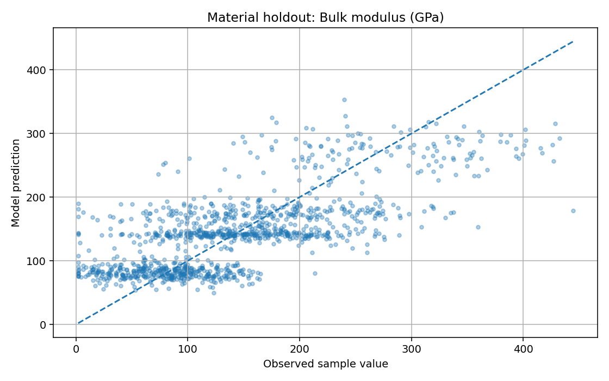
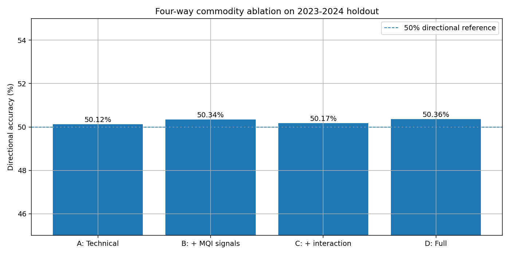
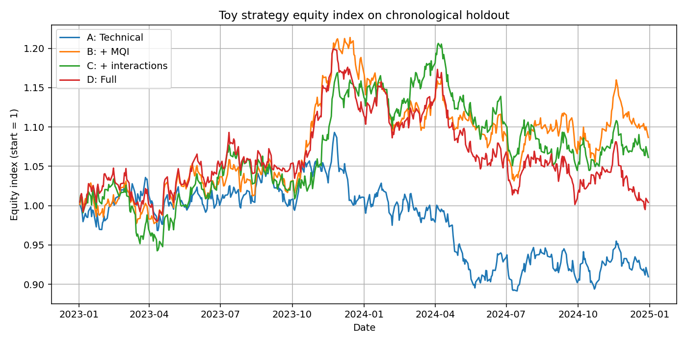
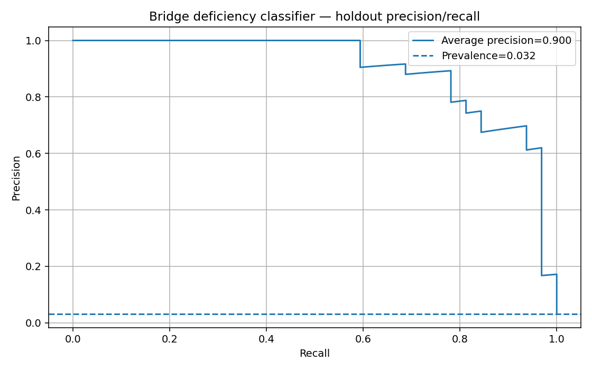
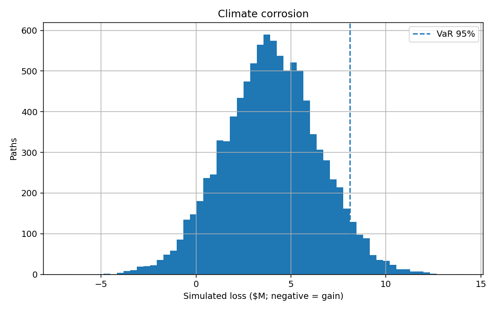

# MatRisk AI: A Practical Prototype for Material-Financial Risk Modelling

**Project category:** Data Science, AI/ML, Material Science and Financial Risk Analytics  
**Prepared by:** Lokesh Thakare  
**Project period:** Internship prototype based on the supplied MatRisk AI brief  
**Version:** 0.1.0  
**Data window in the supplied samples:** Commodity history from 2 January 2014 to 31 December 2024

> **Scope statement.** This report documents a working prototype built from the six supplied sample CSVs. It does not claim to have implemented the full CGNN, trained PINN, WGAN-GP, survival network, 100K+ external-data ingestion or production-grade financial models listed in the original brief. All results below are from the implementation described in the repository, and simulation assumptions are labelled as assumptions.

<!-- PAGEBREAK -->

# Abstract and executive summary

MatRisk AI explores how computational material information might improve financial decisions for commodity markets and infrastructure assets. The motivating idea is straightforward: material composition and degradation affect strength, fatigue, corrosion and substitution options; these physical conditions can affect repair cost, asset life, insurance loss and commodity supply. A financial model that ignores these links may miss useful context, but adding material features does not guarantee predictive improvement.

The prototype joins six provided datasets: material properties, historical commodity prices, bridge condition data, cross-domain material-financial indicators, element prices and historical failure events. It implements three predictive baselines: an ExtraTrees regression model for four material properties, a HistGradientBoosting return model for a chronological commodity holdout, and a Random Forest classifier for structural deficiency. It also includes basic physics checks, expected-loss arithmetic, Monte Carlo scenario analysis, a carbon substitution calculator, a screening page for existing materials, and a small campaign-style simulation game.

The material model's holdout MAE was 0.741 eV/atom for formation energy, 0.881 eV for band gap, 47.05 GPa for bulk modulus and 32.51 GPa for shear modulus. These errors do not meet the specialist-model targets in the brief, especially for elastic properties. The four-way commodity ablation produced directional accuracy between 50.12% and 50.36%; the full model had a toy strategy Sharpe ratio of 0.006. The sample therefore does not demonstrate strong commodity alpha. The bridge classifier's ROC-AUC was 0.9922 and average precision 0.9002, but structural-deficiency prevalence in the holdout was only 3.2%; such a high result should be checked for synthetic label rules and does not establish real-world performance.

The main contribution is a connected, inspectable workflow and a clear evaluation baseline. Next steps are better crystal-structure data, true survival labels, externally validated financial inputs, calibrated uncertainty, and the requested graph and physics-informed architectures.

<!-- PAGEBREAK -->

# Chapter 1 — Introduction

## 1.1 Problem statement

Materials and finance are often analysed using different tools. Materials models predict properties such as stiffness, density, band gap or corrosion resistance. Financial models estimate returns, loan losses, insurance claims and portfolio risk. In sectors where physical assets are made from engineered materials, these two views are related. A bridge with a high corrosion rate may need earlier maintenance. A change in steel quality can affect structural reliability and the relative value of commodity grades. A recycled-material requirement can change both emissions and procurement cost.

MatRisk AI proposes an integrated workflow that translates material-level information into features a financial analyst can inspect. The project brief names four end-use areas: commodity trading, infrastructure project finance, catastrophe insurance and ESG portfolio analytics. The same physical event can affect them differently, so the pipeline needs separate target definitions and validation methods rather than one universal risk score.

## 1.2 Research questions

This prototype addresses four practical questions:

1. Can a tabular model learn a useful first approximation of material properties from formula and structural descriptors?
2. Does adding sample material-financial features improve next-day commodity-return prediction on a strictly later time period?
3. Can bridge condition attributes be used to rank records by structural-deficiency risk, and what assumptions are introduced when converting that score into financial loss?
4. Can a transparent scenario simulator help users understand how material shocks propagate through exposure, risk mitigation and sustainability trade-offs?

## 1.3 Contribution and boundaries

The contribution is a runnable baseline, not a claim of a new scientific discovery. The implementation prioritises reproducibility, tests, temporal validation and making assumptions visible. The full assignment asks for 27 deliverables, including graph models, PINN constraints, a generative adversarial network, survival analysis, SHAP/PDP explainability, DVC, MLflow, Docker and an extended report. The present implementation covers a subset and documents the remaining gaps instead of marking them complete without evidence.

<!-- PAGEBREAK -->

# Chapter 2 — Literature review I: material representation and prediction

## 2.1 Descriptor-based learning

A descriptor-based model converts a material into a fixed-length feature vector. Examples include elemental fractions, atomic radii, electronegativity summaries, crystal system and unit-cell descriptors. Tree ensembles are a practical baseline because they can learn non-linear interactions without requiring a deep-learning training pipeline [8, 9]. Their weakness is that feature engineering determines much of the information available to the model. A formula string and a few structure descriptors do not encode all local atomic geometry.

In this prototype, the formula is represented by character n-grams and is combined with the number of elements, crystal system, category, space-group number, site count and unit-cell volume. This is deliberately simpler than the 132 Magpie descriptors described in the brief. It allows the model to train quickly from the supplied file, but it is not a substitute for composition featurisation with Matminer or for explicit atomic coordinates.

## 2.2 Crystal graph neural networks

Crystal Graph Convolutional Neural Networks (CGCNN) represent atoms as graph nodes and interatomic neighbourhoods as edges. Message passing allows each node to learn from nearby atoms before a pooling stage produces a crystal-level representation [1]. MEGNet extends graph-network ideas to molecules and crystals and uses global state information alongside nodes and edges [2]. SchNet learns continuous-filter interactions from atomic distances [3], while ALIGNN explicitly models the line graph to include bond-angle information [4]. These approaches need structural information such as atomic sites, coordinates and lattice geometry.

The supplied DS-1 file contains formula, crystal system, space group, volume and scalar properties, but does not provide a coordinate list for every unit cell. That is why the project does not fabricate a crystal graph from the available columns. A real graph pipeline should acquire structures through a source such as the Materials Project API or JARVIS-DFT [5, 6, 7], then version the retrieval date and calculation settings.

## 2.3 Material data limitations

Computational materials records are commonly generated with density functional theory (DFT), while experimental measurements may differ because of temperature, defects, microstructure and processing. A model evaluation must state the source and target definition. A good random test split can still overstate generalisation when closely related compounds appear in both sets. The prototype therefore groups formula records by their elemental system for its holdout split, while recognising that this grouping is not a complete solution to materials leakage.

<!-- PAGEBREAK -->

# Chapter 2 — Literature review II: physics-informed learning and risk

## 2.4 Physics-informed learning

A physics-informed neural network includes known relationships in its training objective rather than fitting only observed labels [10, 11]. In the brief, the most directly checkable elastic relationship for isotropic materials is:

`E = 2G(1 + nu) = 3K(1 - 2nu)`

where `E` is Young's modulus, `G` is shear modulus, `K` is bulk modulus and `nu` is Poisson's ratio. The raw data audit calculates the relative difference between the two estimates of `E`. A prediction post-processing step derives `nu = (3K - 2G) / (2(3K + G))` from positive predicted `K` and `G`, so both estimates are algebraically consistent for the displayed approximation. This is not a PINN: no neural network was trained with physics losses. It is a small example of enforcing a known relationship at the output stage.

Paris' law, `da/dN = C(Delta K)^m`, describes fatigue crack growth in an appropriate regime [12]. Using it well requires material-specific coefficients, stress intensity and a clearly defined crack-growth regime. The sample bridge file includes `paris_C` and `paris_m`, but it does not supply the complete crack geometry and inspection histories needed to validate a full fatigue-life model here.

## 2.5 Survival analysis and structural risk

Survival analysis models time until an event while accounting for observations where the event has not yet occurred. Cox's proportional hazards model provides a widely used statistical foundation [13]; DeepSurv shows how a neural network can replace the linear risk function [14]. The required input is more than a current condition label: one needs event time, event indicator or censoring status, and dated covariates. DS-3 is a bridge snapshot with a structural-deficiency label, not a validated time-to-failure dataset. The prototype therefore uses classification rather than calling the output a survival curve.

## 2.6 Financial loss and interpretability

The standard expected-loss identity is `EL = PD x LGD x EAD`, but every input must have a defined horizon and exposure basis. Tail risk also matters for rare catastrophic events; Expected Shortfall averages losses beyond a chosen quantile [15, 16]. Feature attribution approaches such as SHAP explain contributions to individual predictions, but explanation is not proof of causality [17]. The next-stage system should use calibrated probabilities, out-of-time backtesting, confidence intervals and domain review before any model output is used to price loans, insurance or trades.

<!-- PAGEBREAK -->

# Chapter 3 — Data and quality assessment

## 3.1 Dataset inventory

The six supplied CSV files contain 5,500 material records, 22,952 commodity observations, 5,000 bridge records, 22,952 cross-domain rows, 5,280 monthly element-price rows and 2,000 historical failure records. The commodity data covers eight series from 2014-01-02 through 2024-12-31. These counts were computed from the local files. The datasets are treated as project samples; this report does not claim that they are live production feeds or independently verified observations.

## 3.2 Completeness and basic physical checks

The sample material, bridge, element-price and historical-failure tables have no missing cells in the supplied CSVs. The price table has approximately 0.501% missing cells, mostly consistent with warm-up periods for rolling indicators; the cross-domain table has approximately 0.259% missing cells. Price records are dropped where required features or the next-day target are missing, rather than filled with future values.

All rows in DS-1 have positive bulk modulus, positive shear modulus and positive density, and all supplied Poisson ratios fall between -1 and 0.5. With a 10% relative-gap tolerance, 95.0% of the supplied records satisfy the tested elastic-moduli relationship; the median relative gap is 3.46%. That 95.0% is a raw-data audit, not the percentage of predictions produced by a PINN. It should also be read with the chosen tolerance and the assumptions of isotropic elasticity.

## 3.3 Risk label prevalence and class imbalance

Only 3.24% of the bridge records are labelled structurally deficient. The holdout prevalence is 3.2%. This class imbalance means that accuracy alone would be misleading: a classifier predicting “not deficient” for every bridge would already be correct on most rows. The evaluation therefore includes ROC-AUC, average precision and Brier score. The very high ROC-AUC obtained on this sample should prompt checks for data-generation rules or strong proxy features before any external interpretation.

## 3.4 Reproducibility

Random seeds are fixed at 42 where relevant. The trained models, metrics and figures can be recreated with the commands in the README. A DVC pipeline definition is included, but a working DVC remote and externally backed-up tracked datasets still need to be configured by the student or team.

<!-- PAGEBREAK -->

# Chapter 3 — Material model methodology

## 3.5 Target and feature design

The material model jointly predicts formation energy, band gap, bulk modulus and shear modulus. The input combines formula character n-grams with `n_elements`, `spacegroup_number`, `nsites`, `volume_A3`, `crystal_system` and `category`. It does not use the target fields as input and does not use the provided Poisson ratio as a predictor. The estimator is ExtraTrees with 80 trees, a maximum depth of 24, a minimum leaf size of 3 and a fixed random seed.

The holdout is generated with `GroupShuffleSplit` using a chemical-system key composed of the sorted elements in the formula. The resulting split contains 4,334 training rows and 1,166 test rows. This is a more conservative split than random rows, but chemical-system grouping does not guarantee that every chemical or structural similarity has been isolated.

## 3.6 Metrics

For each target, the report records mean absolute error (MAE), root mean squared error (RMSE) and coefficient of determination (R-squared). MAE is easier to interpret in the target unit, while RMSE penalises larger errors more heavily. R-squared describes performance relative to a constant-mean baseline on the same holdout; it does not establish scientific validity.

## 3.7 Physics post-processing

After the estimator predicts `K` and `G`, the displayed Poisson ratio is derived using the isotropic relation. Young's modulus is then computed from both paths and their relative difference is displayed. This ensures the displayed moduli are self-consistent algebraically, but it does not force all model properties to match laboratory truth or guarantee that the material is stable under every temperature, loading or microstructural condition.

## 3.8 Why this baseline was chosen

The simpler estimator is a practical way to establish a baseline and test the data pipeline. A genuine CGNN requires unit-cell structures and atom-neighbour graphs; a trained PINN requires a model objective containing the relevant physics residuals. Those components are the correct next research steps, rather than labels to attach to this baseline.

<!-- PAGEBREAK -->

# Chapter 3 — Commodity feature engineering and evaluation

## 3.9 Cross-domain join

The project merges DS-2 commodity prices with DS-4 material-financial indicators on `(date, commodity)`. The key columns include MQI and its trends, supply-disruption probability, substitution elasticity, green premium, carbon intensity and concentration index. A one-to-one merge validation is used so duplicated join keys fail loudly.

The target is the next trading day's log return, created by shifting `daily_return` one row forward within each commodity after sorting by date. This avoids training the model to predict the already observed return. Technical indicators with look-back windows are allowed because they are available at the prediction date, subject to the quality of the source data.

## 3.10 Chronological split and ablation variants

Training uses dates before 1 January 2023; the test period begins on 1 January 2023 and extends to the last available sample date. The test set contains 4,168 observations after rows with missing model features and targets are removed. Four variants follow the assignment's ablation idea:

- **A:** technical and price-history features only.
- **B:** A plus MQI level and MQI trend features.
- **C:** A plus supply, substitution, green-premium, carbon and concentration features.
- **D:** A plus all the material and cross-domain features.

Each model uses HistGradientBoostingRegressor with fixed settings. The toy trading calculation takes a long position when the predicted return is positive and a short position when negative, charging a 10-basis-point cost whenever position size changes. This deliberately simple rule exposes one financial metric, but it omits realistic position sizing, liquidity, contract rolls, borrow constraints and risk limits.

## 3.11 Limitations of the financial experiment

The indicators were supplied as sample data, and the target noise is large relative to the prediction. A tiny gain in directional accuracy should not be confused with statistically significant alpha. A stronger evaluation would use repeated walk-forward windows, multiple-hypothesis controls, block-bootstrap confidence intervals and a market-specific strategy that includes realistic transaction costs and tradable instrument definitions.

<!-- PAGEBREAK -->

# Chapter 3 — Infrastructure risk, stress testing and ESG calculations

## 3.12 Bridge deficiency classifier

A Random Forest classifier estimates the `structurally_deficient` label from material, age, corrosion environment and rate, bridge type, traffic, strength, thickness and fatigue-related fields. The condition rating itself is not used as a feature, to avoid directly leaking a closely related indicator into the target. The split is stratified and contains 4,000 training and 1,000 holdout records.

The financial table computes an illustrative expected-loss proxy:

`EL_proxy = P(structurally deficient) x LGD_proxy x EAD`

Here, `EAD` is the sample's outstanding loan balance. `LGD_proxy` is based on the clipped mean of sample historical loss ratios with a small condition adjustment. Because the target is not annual default over a loan horizon, the output must not be presented as a banking-grade PD/LGD/EL model.

## 3.13 Stress scenarios

Five assignment scenarios are represented: rare-earth supply crisis (40% export reduction), steel quality shift (15% tensile-strength reduction), climate corrosion (30% rate increase), recycled-material mandate (50% recycled-content requirement), and novel-alloy discovery (20% stronger/cheaper substitute). The simulator samples 10,000 normal random paths around declared mean-impact and uncertainty rates. Those rates are in `src/matrisk/stress.py`; they are explicit assumptions for the learning game, not empirically estimated transmission functions.

The engine reports expected loss, VaR at 95% and 99%, TVaR at 99.5%, maximum simulated loss and the proportion of paths with a gain. A gain can produce a negative expected loss for the novel-alloy scenario, while the upper tail can still contain losses because uncertainty is non-zero.

## 3.14 ESG and screening

The ESG calculator compares emissions from virgin and recycled material using the latest DS-4 sample values and multiplies the intensity difference by the user-specified quantity. The material screening page ranks existing DS-1 materials by bulk-modulus fit, density and a weighted elemental-price proxy from DS-5. This cost proxy excludes processing and fabrication costs; it is not a manufacturing quote and it is not a generative model.

<!-- PAGEBREAK -->

# Chapter 4 — Results: material property prediction

The grouped material holdout contains 1,166 records. Observed performance is shown below. The project brief's ambitious specialist-model targets are included for context but were not reached by this baseline.

**Holdout performance by property**

- **Formation energy:** MAE 0.741 eV/atom; RMSE 0.940 eV/atom; R² 0.5889. Brief target MAE: ≤ 0.040 eV/atom.
- **Band gap:** MAE 0.881 eV; RMSE 1.385 eV; R² 0.6914. Brief target MAE: ≤ 0.40 eV.
- **Bulk modulus:** MAE 47.05 GPa; RMSE 59.87 GPa; R² 0.5054. Brief target MAE: ≤ 12 GPa.
- **Shear modulus:** MAE 32.51 GPa; RMSE 43.71 GPa; R² 0.3345. Brief target MAE: ≤ 10 GPa.

The weakest result is shear modulus, for which R² is 0.3345. The scatter plot shows that extreme values are pulled toward the central range, which is a common limitation of a tree ensemble on an incomplete feature representation. The result suggests that formula n-grams and coarse descriptors are not enough to reproduce the reference accuracy targets on this grouped split. Full crystal structures, richer composition features, consistent calculation protocols, target-specific tuning and comparison against simple mean/physics baselines are important next steps.

The raw data audit found positive K, G and density for 100% of records, valid Poisson bounds for 100%, and 95.0% satisfying the elastic equality within a 10% relative-gap tolerance. These findings describe the supplied records and the chosen audit rule. They are not model accuracy and are not evidence that a trained PINN has been implemented.

<!-- PAGEBREAK -->

# Chapter 4 — Results: commodity ablation

The out-of-time commodity test spans the sample's 2023-2024 observations and contains 4,168 rows. Results below are measured from the provided sample using the time split defined in the code.

**Out-of-time results**

- **A - Technical only:** MAE 0.016486; directional accuracy 50.12%; toy Sharpe -0.137; sum strategy log returns -0.7585; maximum drawdown proxy -80.92%.
- **B - Technical + MQI:** MAE 0.016462; directional accuracy 50.34%; toy Sharpe 0.120; sum strategy log returns 0.6645; maximum drawdown proxy -60.49%.
- **C - Technical + interactions:** MAE 0.016492; directional accuracy 50.17%; toy Sharpe 0.086; sum strategy log returns 0.4756; maximum drawdown proxy -57.21%.
- **D - Full model:** MAE 0.016489; directional accuracy 50.36%; toy Sharpe 0.006; sum strategy log returns 0.0321; maximum drawdown proxy -74.60%.

Variant D has the highest directional accuracy by only 0.24 percentage points compared with the technical-only model, while its MAE is slightly worse than variant B. Variant B produces the best toy Sharpe among these four on this specific holdout, but 0.120 remains below the assignment's target of 0.5, and the test has not been repeated across many walk-forward periods. The full model is not automatically best simply because it has more features. The result is a reason to investigate feature quality, model calibration, regime dependence and transaction-cost sensitivity rather than a claim of strong alpha.

The equity calculation is a deliberately simplified long/short signal with position-change costs. Because the toy strategy is very sensitive to the sign of small predicted returns, it is not a trading recommendation.

<!-- PAGEBREAK -->

# Chapter 4 — Results: bridge risk, stress and ESG

## 4.1 Bridge classifier

On a stratified holdout of 1,000 bridge records, the classifier produced ROC-AUC 0.9922, average precision 0.9002 and Brier score 0.01296, with positive prevalence 3.2%. These values look strong, but the imbalance and near-separability should be treated as a warning. A realistic check would compare feature distributions and label construction with official bridge inspection records, examine positive-class calibration, use a later inspection-period holdout, and test on data from a different jurisdiction.

## 4.2 Stress example

The following summary uses USD 100 million of exposure and 10,000 simulated paths. Values depend on the declared teaching assumptions.

**Monte Carlo examples for a USD 100 million exposure**

- **Rare earth supply crisis:** assumed mean impact +2.5%; expected loss USD 2.48M; VaR 95% USD 5.29M; TVaR 99.5% USD 7.49M.
- **Steel quality shift:** assumed mean impact +6.0%; expected loss USD 5.97M; VaR 95% USD 10.93M; TVaR 99.5% USD 14.80M.
- **Climate corrosion:** assumed mean impact +4.0%; expected loss USD 3.97M; VaR 95% USD 8.11M; TVaR 99.5% USD 11.33M.
- **Recycled-material mandate:** assumed mean impact +1.5%; expected loss USD 1.49M; VaR 95% USD 3.14M; TVaR 99.5% USD 4.43M.
- **Novel alloy discovery:** assumed mean impact -2.5%; expected loss -USD 2.52M; VaR 95% USD 0.79M; TVaR 99.5% USD 3.37M.

## 4.3 ESG example

For a 10,000 kg steel-HRC reference quantity, the sample carbon intensities implied by the supplied DS-4 rows are 2.09 kg CO₂e/kg for virgin material and 0.38 kg CO₂e/kg for recycled material. The simple calculation reports 17.1 tonnes CO₂e avoided and an incremental green-premium cost of USD 1,480. The resulting cost per tonne avoided is about USD 86.55 under those inputs. These values are sample-driven and must not be used in a formal ESG disclosure until system boundaries and supplier-specific data are confirmed.

<!-- PAGEBREAK -->

# Chapter 4 — Prototype experience and integration

The Streamlit application is organised into seven sections: overview, material property explorer, commodity signals, infrastructure risk, inverse material screening, ESG impact and the MatRisk Lab game. The UI links model outputs to contextual notes so that a user sees the main estimate and the reason it should be treated cautiously. A small FastAPI wrapper exposes a health endpoint, a material prediction endpoint and a stress endpoint.

The game implements two campaign levels. Level 1 introduces a steel bridge and steel commodity position. Level 2 injects one of the five material-financial shocks. The player may invest in inspection/maintenance, reduce exposed commodity risk, diversify suppliers or do nothing. A scenario is resolved into baseline expected loss, avoided loss, action cost, net loss and a score out of 1,000. Both mitigation fractions and intervention costs are declared in code. That transparency is a feature: a supervisor can change assumptions and observe how the optimal decision changes.

The inverse-design page is called “screening” because it does not generate new atomic compositions. It compares known sample records with user-selected property and cost-proxy constraints. To meet the assignment's full inverse-design requirement, the next version would need a trained property model for proposed compositions, a physically valid generator, a cost model, and a separate validation set for generated candidates.

Automated tests cover data loading, formula grouping, next-day target shifting, deterministic stress output, parameter validation, game scoring, ESG arithmetic, formula parsing and elastic post-processing. The expanded automated suite passed 19 tests and reported 97% statement coverage across the `src/matrisk` package in the local test run. The Streamlit interface was not launched in this build environment because Streamlit is not installed there; the dashboard code is included for local installation and review.

<!-- PAGEBREAK -->

# Chapter 5 — Discussion and limitations

## 5.1 What worked

The project combines the six supplied datasets into a repeatable local training workflow. It demonstrates group-aware material evaluation, a strictly later commodity test period, a classifier evaluated with imbalance-aware metrics, and transparent risk and ESG calculations. Tests catch several common implementation mistakes, especially accidentally using same-day instead of next-day returns and accepting invalid simulation parameters.

## 5.2 What did not meet the brief

The material model does not achieve the target errors and is not a CGNN. Physics enforcement is algebraic post-processing rather than a PINN loss. The commodity backtest does not demonstrate a Sharpe above 0.5. Infrastructure risk uses a binary deficiency classifier instead of a survival model with censoring and time-dependent survival curves. The inverse-design page ranks known materials rather than training a WGAN-GP. Full SHAP/PDP, data ingestion from 100K+ external material records and NBI, DVC remote configuration, MLflow experiment logging, 10K-path sensitivity curves at 50-200% shock levels, and full CI/Docker verification remain incomplete.

## 5.3 Why these boundaries matter

A highly accurate score on a small supplied sample may reflect simplified labels rather than real causal signal. Engineering data are affected by climate, construction practice, inspections, maintenance and measurement error. Market returns are noisy and non-stationary. A financial risk estimate also depends on exposure definitions, time horizon, portfolio dependence and legal terms. Joining the datasets is therefore only the first step; every model needs domain-specific validation.

## 5.4 Responsible use

The output is an educational prototype only. It should not be used to price insurance, decide whether a bridge is safe, grant or refuse a loan, or execute a trade. Engineering decisions require qualified review and verified inspections. Financial decisions require validated inputs, compliance controls and a model-risk management process. Assumptions in the simulator should be presented next to outputs, not hidden inside code.

<!-- PAGEBREAK -->

# Chapter 6 — Conclusion and future work

MatRisk AI's core idea is useful as a research direction: physical-material evidence can provide an additional lens for financial risk decisions where assets depend on steel, concrete, alloys, battery materials or critical minerals. In this prototype, the initial bridge is visible in the code: material-property estimates and cross-domain indicators feed separate analysis pages; asset deficiency estimates are translated into an explicitly labelled loss proxy; scenarios turn a material shock into a simulated distribution; and the ESG page places emissions reduction alongside cost.

The measured findings are mixed. The tabular material model is a baseline but misses the assignment's specialist error targets. Cross-domain features slightly improve directional commodity accuracy, but no variant achieves the requested Sharpe benchmark. The bridge classifier reports high ranking metrics on the supplied sample, which should trigger a data-generation and leakage audit rather than immediate confidence. Stress and ESG outputs are calculations under stated assumptions rather than empirically validated forecasts.

Recommended next steps are: (1) acquire and version full crystal structures and use Matminer descriptors; (2) implement and benchmark CGNN or ALIGNN using chemical-system splits; (3) train a real PINN loss for all defined physical constraints and report a prediction-level audit; (4) acquire dated bridge inspection histories with event/censoring information and fit a survival model; (5) run repeated walk-forward commodity backtests, bootstrap confidence intervals and realistic transaction costs; (6) calibrate stress transmission using external evidence; and (7) add experiment tracking, DVC remote storage, CI coverage checks and a reproducible Docker test. These steps would move the project from a teaching prototype toward the larger research programme described in the assignment.

The main lesson from this implementation is that an integrated workflow is only valuable when its links can be tested. A material signal should earn its place in a financial model by improving out-of-time performance, surviving sensitivity analysis and remaining interpretable to a domain expert.

<!-- PAGEBREAK -->

# References

1. Xie, T. and Grossman, J.C. (2018). “Crystal Graph Convolutional Neural Networks for an Accurate and Interpretable Prediction of Material Properties.” *Physical Review Letters*, 120, 145301. https://doi.org/10.1103/PhysRevLett.120.145301
2. Chen, C. et al. (2019). “Graph Networks as a Universal Machine Learning Framework for Molecules and Crystals.” *Chemistry of Materials*, 31(9), 3564–3572. https://doi.org/10.1021/acs.chemmater.9b01294
3. Schütt, K.T. et al. (2018). “SchNet: A continuous-filter convolutional neural network for modeling quantum interactions.” *Journal of Chemical Physics*, 148, 241722. https://doi.org/10.1063/1.5019779
4. Choudhary, K. and DeCost, B. (2021). “Atomistic Line Graph Neural Network for Improved Materials Property Predictions.” *npj Computational Materials*, 7, 185. https://doi.org/10.1038/s41524-021-00650-1
5. Jain, A. et al. (2013). “Commentary: The Materials Project: A materials genome approach to accelerating materials innovation.” *APL Materials*, 1, 011002. https://doi.org/10.1063/1.4812323
6. Materials Project. “Using the API” and data download documentation. https://docs.materialsproject.org/downloading-data/using-the-api
7. NIST. “JARVIS databases.” https://jarvis.nist.gov/
8. Breiman, L. (2001). “Random Forests.” *Machine Learning*, 45, 5–32. https://doi.org/10.1023/A:1010933404324
9. Friedman, J.H. (2001). “Greedy Function Approximation: A Gradient Boosting Machine.” *The Annals of Statistics*, 29(5), 1189–1232. https://doi.org/10.1214/aos/1013203451
10. Raissi, M., Perdikaris, P. and Karniadakis, G.E. (2019). “Physics-informed neural networks: A deep learning framework for solving forward and inverse problems involving nonlinear partial differential equations.” *Journal of Computational Physics*, 378, 686–707. https://doi.org/10.1016/j.jcp.2018.10.045
11. Karniadakis, G.E. et al. (2021). “Physics-informed machine learning.” *Nature Reviews Physics*, 3, 422–440. https://doi.org/10.1038/s42254-021-00314-5
12. Paris, P. and Erdogan, F. (1963). “A critical analysis of crack propagation laws.” *Journal of Basic Engineering*, 85(4), 528–533. https://doi.org/10.1115/1.3656900
13. Cox, D.R. (1972). “Regression Models and Life-Tables.” *Journal of the Royal Statistical Society: Series B*, 34(2), 187–220. https://doi.org/10.1111/j.2517-6161.1972.tb00899.x
14. Katzman, J.L. et al. (2018). “DeepSurv: personalized treatment recommender system using a Cox proportional hazards deep neural network.” *BMC Medical Research Methodology*, 18, 24. https://doi.org/10.1186/s12874-018-0482-1
15. Artzner, P. et al. (1999). “Coherent measures of risk.” *Mathematical Finance*, 9(3), 203–228. https://doi.org/10.1111/1467-9965.00068
16. Acerbi, C. and Tasche, D. (2002). “Expected Shortfall: A natural coherent alternative to Value at Risk.” *Economic Notes*, 31(2), 379–388. https://doi.org/10.1111/1468-0300.00091
17. Lundberg, S.M. and Lee, S.-I. (2017). “A Unified Approach to Interpreting Model Predictions.” *Advances in Neural Information Processing Systems 30*. https://proceedings.neurips.cc/paper/2017/hash/8a20a8621978632d76c43dfd28b67767-Abstract.html
18. Chen, T. and Guestrin, C. (2016). “XGBoost: A Scalable Tree Boosting System.” *Proceedings of KDD 2016*, 785–794. https://doi.org/10.1145/2939672.2939785
19. Taylor, R.H. et al. (2014). “A RESTful API for exchanging materials data in the AFLOWLIB.org consortium.” *Computational Materials Science*, 93, 178–192. https://doi.org/10.1016/j.commatsci.2014.05.014
20. Federal Highway Administration. “National Bridge Inventory.” https://www.fhwa.dot.gov/bridge/nbi.htm
21. U.S. Geological Survey. “Mineral Commodity Summaries.” https://www.usgs.gov/centers/national-minerals-information-center/mineral-commodity-summaries
22. International Capital Market Association. (2025). “Green Bond Principles: Voluntary Process Guidelines for Issuing Green Bonds.” https://www.icmagroup.org/assets/documents/Sustainable-finance/2025-updates/Green-Bond-Principles-GBP-June-2025.pdf
23. McNeil, A.J., Frey, R. and Embrechts, P. (2015). *Quantitative Risk Management: Concepts, Techniques and Tools*, revised edition. Princeton University Press.
24. Steyerberg, E.W. (2019). *Clinical Prediction Models*, 2nd ed. Springer.
25. scikit-learn developers. “Ensemble methods and model evaluation documentation.” https://scikit-learn.org/stable/supervised_learning.html
26. Streamlit. “Get started documentation.” https://docs.streamlit.io/
27. DVC. “Get started with data versioning.” https://dvc.org/doc/start
28. Matminer documentation. “Materials data mining and feature engineering.” https://hackingmaterials.lbl.gov/matminer/
29. PyMatGen documentation. “Python Materials Genomics.” https://pymatgen.org/
30. MatRisk AI internship project brief and its DS-1 to DS-6 sample-dataset README supplied for this assessment. (Unpublished project materials; use according to the applicable confidentiality terms.)
